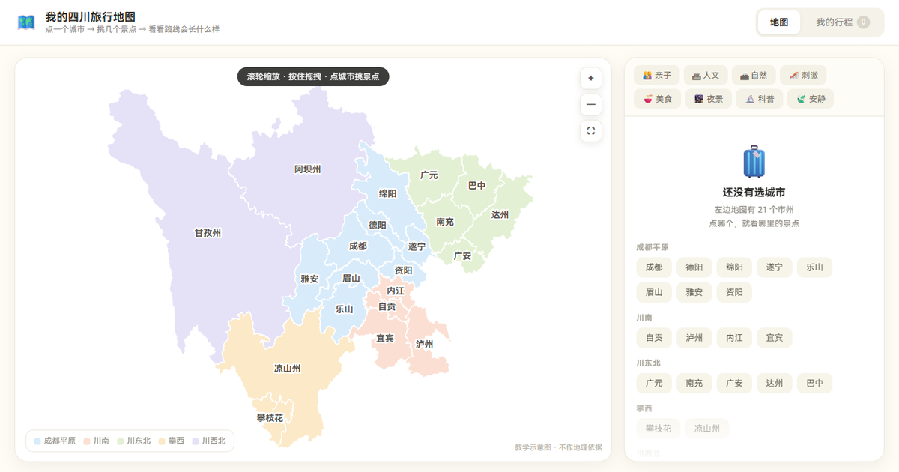

# 我的四川旅行地图

在四川省地图上点一个城市、挑几个景点、加入行程，网页就会按你加入的顺序连成一条路线，并算出总里程。

纯静态单文件，**零依赖、不用服务器、断网也能打开**，可以直接发给家长或同学。



---

## 它能做什么

| 功能 | 说明 |
| --- | --- |
| 21 个市州 | 按成都平原 / 川南 / 川东北 / 攀西 / 川西北五大片区配色，带图例 |
| 滚轮缩放 | 以鼠标位置为锚点放大，缩略时只看总览，放大到一定程度景点才逐级出现 |
| 拖拽平移 | 按住拖动，右侧有 ＋ / － / 复位按钮，手机上用手指 |
| 63 个景点 | 每个都有真实照片、一句话简介、详细介绍、建议时长、门票参考、贴士 |
| 8 类标签 | 亲子 / 人文 / 自然 / 刺激 / 美食 / 夜景 / 科普 / 安静，可多选筛选 |
| 我的行程 | 按加入顺序编号、连线、算距离，可上下移动、可删除 |
| 自动保存 | 关掉浏览器再打开，行程还在（localStorage） |

---

## 直接体验

下载后双击 `index.html` 就能用。想发布到网上让别人也能看，见下一节。

配套的**《提示词手册》**在 `prompts.html`：5 节课、28 条提示词，每条都带「检查点」和「翻车了怎么办」。

---

## 发布到 GitHub Pages（免费，5 分钟）

### 1. 新建仓库

打开 <https://github.com/new>，填一个仓库名，例如 `sichuan-travel-map`，选 **Public**（私有仓库用 Pages 需要付费），不要勾选任何初始化文件，点 **Create repository**。

### 2. 上传文件

在新建好的仓库页面点 **uploading an existing file**，把本项目里的**全部内容**拖进去：

```
index.html          README.md
prompts.html        .gitignore
.nojekyll           assets/          ← 里面有 63 张图
source/             ← 原始素材和构建脚本，网站不会加载它
```

> **注意**：只上传这个文件夹里的东西。不要把外面的 `output/`、`shots/`、Python 临时脚本一起传上去。
>
> `.nojekyll` 是个空文件，Windows 资源管理器可能不显示。它用来关掉 GitHub 的 Jekyll 处理，避免路径出错。漏传一般也能跑，但建议带上。

习惯用命令行的可以这样：

```bash
git init
git add .
git commit -m "四川旅行地图"
git branch -M main
git remote add origin https://github.com/<你的用户名>/<仓库名>.git
git push -u origin main
```

### 3. 打开 Pages

进入仓库 **Settings → Pages**：

- **Source** 选 `Deploy from a branch`
- **Branch** 选 `main`，目录选 `/ (root)`
- 点 **Save**

等 1～2 分钟，页面顶部会出现你的网址：

```
https://<你的用户名>.github.io/sichuan-travel-map/
```

### 4. 常见问题

| 现象 | 原因与解决 |
| --- | --- |
| 打开是 404 | 刚保存要等一会儿；确认分支是 `main` 且目录是 `/ (root)`；确认根目录有 `index.html` |
| 页面能开但图片全裂 | `assets/spots/` 没传上去，或者被传成了 `spots/` 少一层目录 |
| 样式全丢、只有文字 | 文件被存成了别的编码，重新下载一次本项目的 `index.html` 覆盖 |
| 改了数据但页面没变 | 浏览器缓存，按 `Ctrl + F5` 强制刷新；Pages 有时需要 1～2 分钟重新构建 |

---

## 目录结构

```
.
├── index.html            ← 主程序（数据已内联，直接打开就能跑）
├── prompts.html          ← 学生提示词手册（5 节课 28 条提示词）
├── assets/
│   ├── og-cover.png      ← 分享到微信 / 社交平台的预览图
│   └── spots/            ← 63 张景点照片 01.webp ~ 63.webp（640×288）
└── source/               ← 原始素材与构建脚本，网站本身不加载
    ├── template.html     ← 界面模板（含 /*__MAP_DATA__*/ 和 /*__SPOTS__*/ 两个占位符）
    ├── spots.js          ← 63 条景点数据
    ├── map_paths.js      ← 21 个市州的 SVG 路径与投影参数
    ├── sc_raw.json       ← 四川省 GeoJSON 原始数据（阿里云 DataV）
    ├── gen_map.py        ← 由 GeoJSON 生成 map_paths.js
    └── build.py          ← 把数据注入模板，重新生成 index.html
```

---

## 改成你自己的

### 换景点

打开 `source/spots.js`，每条长这样：

```js
{u:'成都', n:'大熊猫繁育基地', lon:104.145, lat:30.735, e:'🐼',
 t:'半天', fee:'约 ¥55', tags:['亲子','自然','科普'],
 d:'看熊猫吃竹子、爬树、打滚，早上刚喂过食最活跃。',
 hi:'详细一点的介绍……',
 tip:'七点半前到，先去月亮产房。'},
```

- `u` 必须是市州全称：`成都`、`阿坝州`、`甘孜州`、`凉山州`、`攀枝花`……（21 个里带「州」的三个别写漏）
- `lon` / `lat` 是经纬度，手机上长按地图就能看到大致坐标
- `tags` 只能从这 8 个里选：`亲子` `人文` `自然` `刺激` `美食` `夜景` `科普` `安静`

### 换照片

把新图片命名成 `01.webp` ~ `63.webp`，覆盖 `assets/spots/` 里的同名文件。

建议裁成 **640×288**（16:9 偏宽）、WebP 格式、每张控制在 40KB 以内。图片按景点在 `spots.js` 里的**顺序**对应，第 1 条景点用 `01.webp`。

### 改配色

`index.html` 开头的 `:root` 里改：

```css
--brand:#D85A30;      /* 主色，按钮和强调 */
--r1:#D8EBFA;         /* 成都平原 */
--r2:#FBDFD2;         /* 川南 */
--r3:#E3F0D3;         /* 川东北 */
--r4:#FBE9C7;         /* 攀西 */
--r5:#E5E1F7;         /* 川西北 */
```

> 直接改 `index.html` 也可以，但下次运行 `build.py` 会被覆盖。想长期保存就改 `source/template.html`。

### 改完重新生成

```bash
python source/build.py
```

会重新写出根目录的 `index.html`，刷新浏览器即可。

---

## 数据与版权

- **地图边界**：来自[阿里云 DataV.GeoAtlas](https://datav.aliyun.com/portal/school/atlas/area_selector)，仅作教学示意，不作为地理依据。
- **景点信息**：门票、时长、贴士均为参考值，出行前请以景区公告为准。
- **景点照片**：来自公开网络，仅用于教学演示，版权归原作者所有。正式对外发布建议替换为自己拍摄或已获授权的图片。
- **代码**：可自由用于教学、修改和二次开发。

---

<p align="center"><sub>寒假 AI 课 · 5 节课作品 &nbsp;|&nbsp; 从一张空白网页，到一个能发给爸妈的旅行规划器</sub></p>
